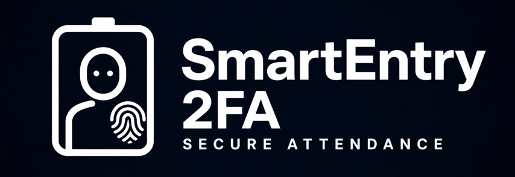

<div align="center">



# 🚀 SmartEntry2FA

### 🔐 Smart Biometric Attendance System

### 👁️ Face Recognition + 👀 Blink Liveness Check + 👆 Fingerprint Verification

<br>


</div>

---

## 🎯 The Problem

Traditional attendance systems are easy to cheat:

- Proxy attendance (a friend marks it for you)
- Photo / phone-screen spoofing in face-only systems
- Manual register manipulation
- Weak, single-factor authentication

**SmartEntry2FA** marks attendance only after **two independent checks** — who you *look like* (face) and who you *are* (fingerprint) — and confirms that both belong to the **same person**.

---

## ✨ Features

### 🔐 Two-Factor Biometric Verification
1. **Factor 1 – Face:** the camera identifies the student (with a blink check to make sure a live person is present).
2. **Factor 2 – Fingerprint:** the Arduino-connected R307 sensor must match **the fingerprint ID that belongs to the student the face was matched to**. A valid fingerprint of a *different* student is rejected.

### 👁️ Face Recognition
- `face_recognition` (dlib) with 128-dimensional face embeddings
- Euclidean-distance matching (tolerance `0.45`), closest match wins
- HOG face detection on a downscaled frame; recognition runs in a background thread so the camera feed stays smooth
- Face-encoding cache for fast start-up, **signed with HMAC-SHA256** and verified before loading (a tampered cache is rejected and rebuilt)

### 👀 Blink-Based Liveness Check
Uses the **Eye Aspect Ratio (EAR)** from facial landmarks. Face matching starts only after a real blink is detected, which blocks simple printed-photo attacks.

```text
EAR = (A + B) / (2 · C)      A, B = vertical eye distances, C = horizontal eye distance
blink = EAR drops below 0.22 and then recovers
```

### 📡 Notifications
- **SMS** via SIM800A GSM module (sent through the Arduino)
- **Email** via Gmail SMTP (SSL, 3 retries) to the student's registered address
- **Voice announcements** (Windows text-to-speech)

> SMS and email are sent **in parallel** after every successful attendance.

### 📊 Admin Panel (password-protected)
- **Analytics dashboard:** search a student by enrollment no./name/ID and see an attendance pie chart + month-wise bar chart
- **Attendance viewer:** filter by date range and department, export to **Excel (.xlsx)** or **PDF**
- **User manager:** search, update and delete students
- **Full system backup:** one-click ZIP of the database, face dataset and cache
- **Hardware diagnostics:** live check of the fingerprint sensor and GSM module

### 🕘 Attendance Rules
- Status is **Present** or **Late** (late after the time set in `LATE_TIME`)
- **One attendance per student per day** (enforced by a unique database index)

### 🛡️ Security Measures
- Admin password stored as a **PBKDF2-HMAC-SHA256** hash (260,000 iterations) — never in plain text
- Login lock-out: 5 wrong attempts → locked for 60 seconds
- Secrets (email app password, admin hash, HMAC key) live in `.env`, not in code; the HMAC key is generated automatically on first run
- HMAC-signed face cache (see above)
- Commands sent to the Arduino are sanitised (commas/newlines stripped)
- SQLite in WAL mode with a lock for thread-safe access, and foreign keys enabled

---

## 🖥️ How It Works

```text
Webcam ─► Face detected ─► Blink verified (EAR) ─► Face matched to a student ID
                                                              │
                                  "VERIFY,<id>" over serial   ▼
                            Arduino + R307 fingerprint sensor (must match the same ID)
                                                              │
                                                              ▼
                               Attendance saved (Present / Late) in SQLite
                                                              │
                                      ┌───────────────────────┴───────────────────────┐
                                      ▼                                               ▼
                         SMS via SIM800A (GSM)                            Email via Gmail SMTP
```

**Registration flow:** fill the student form → face is captured → fingerprint is enrolled on the sensor → the student is saved to the database **only after** the fingerprint enrollment succeeds.

---

## 🧱 Project Structure

```text
SmartEntry2FA/
├── SmartEntry2FA_Main.py        # GUI (CustomTkinter) + main application logic
├── ai_core.py                   # Face engine: blink detection, matching, signed cache
├── hardware.py                  # Arduino serial communication (auto-detect + reconnect)
├── notifications.py             # Email (SMTP) and voice announcements
├── database.py                  # Thread-safe SQLite manager
├── config.py                    # Settings, admin password hashing, HMAC key
├── set_admin_password.py        # Helper: set the admin password
├── build_exe.bat                # Build a standalone Windows app
├── requirements.txt
├── .env.example                 # Template for your private .env
├── logo.ico
├── arduino/
│   └── SmartEntry2FA_Arduino_code/
│       └── SmartEntry2FA_Arduino_code.ino
└── screenshots/
```

Created automatically at run time (and ignored by Git): `smartentry_master.db`, `dataset/`, `encodings.pkl`, `Database_Backups/`, `.env`.

| Table | Purpose |
| --- | --- |
| `Users` | Student details (enrollment, name, department, course, contact) |
| `Attendance` | One row per student per day with time and Present/Late status |

---

## 🔩 Hardware

| Component | Purpose |
| --- | --- |
| Arduino UNO | Main controller (USB serial, 9600 baud) |
| R307 Fingerprint Sensor | Second factor |
| SIM800A GSM Module (with SIM) | SMS alerts |
| 16x2 LCD with I2C module (address `0x27`) | Status display |
| USB Webcam | Face capture |

**Pin connections used in the Arduino sketch**

| Module | Arduino pins |
| --- | --- |
| SIM800A (SoftwareSerial) | D2, D3 |
| R307 fingerprint (SoftwareSerial, 57600 baud) | D4, D5 |
| LCD (I2C) | SDA / SCL (A4 / A5 on UNO) |

**Arduino libraries:** `LiquidCrystal_I2C`, `Adafruit Fingerprint Sensor Library` (install from the Arduino Library Manager).

**Serial commands (PC → Arduino):** `ENROLL,<id>` · `VERIFY,<id>` · `SMS,<number>,<message>` · `CHECK_HW`
**Replies (Arduino → PC):** `ENROLL_SUCCESS` · `ENROLL_FAIL` · `VERIFY_SUCCESS` · `VERIFY_FAIL` · `HW_STATUS:<state>`

---

## ⚙️ Installation (run from source)

> **Platform:** Windows 10/11 only (uses the Windows text-to-speech engine and DirectShow camera access).

### 1. Prerequisites
- Python **3.10+** (tick *Add Python to PATH* while installing)
- For `dlib` (needed by `face_recognition`): install **CMake** and the **Visual Studio C++ Build Tools**, or use a prebuilt `dlib` wheel for your Python version

### 2. Clone and create a virtual environment
```bash
git clone https://github.com/deepakrauniyar963/SmartEntry2FA.git
cd SmartEntry2FA
python -m venv venv
venv\Scripts\activate
```

### 3. Install dependencies
```bash
pip install -r requirements.txt
```

### 4. Configure your private settings
```bash
copy .env.example .env
```
Open `.env` and fill in `EMAIL_USER` and `EMAIL_PASS` (a Gmail **App Password**, not your normal password). Then set the admin password:
```bash
python set_admin_password.py
```

### 5. Upload the Arduino sketch
Open `arduino/SmartEntry2FA_Arduino_code/SmartEntry2FA_Arduino_code.ino` in the Arduino IDE, install the two libraries listed above, select your board/port and upload.

### 6. Connect the hardware and run
```bash
python SmartEntry2FA_Main.py
```

---

## 📦 Build a Standalone Windows App (no terminal needed)

Run once, inside your activated virtual environment:

```bash
build_exe.bat
```

The app is created in `dist\SmartEntry2FA\`. Double-click **`SmartEntry2FA.exe`** (or right-click → *Send to → Desktop (create shortcut)*).

- Keep the whole `SmartEntry2FA` folder together. The `.env`, database, face dataset and backups are stored **next to the .exe**.
- Put the folder in a normal location such as `Documents` — **not** in `Program Files` (the app needs permission to write its data).
- If face recognition fails in the built app, copy the four `.dat` model files from `venv\Lib\site-packages\face_recognition_models\models\` into `dist\SmartEntry2FA\_internal\face_recognition_models\models\`.

---

## 🔒 Privacy & Security Notes

SmartEntry2FA handles **biometric and personal data** (face images, fingerprints, phone numbers, emails).

- This repository contains **no student data, no database, no face images and no credentials** (see `.gitignore`).
- Always get the **consent** of the people you register, and keep the `dataset/`, database and backups private.
- Never commit your `.env`. If a secret is ever pushed by mistake, change it immediately.

**Known limitations**
- Blink detection is a basic liveness check; it is not designed to stop a high-quality video replay or a 3D mask.
- The face cache uses Python `pickle`; it is protected by an HMAC signature, but keep `.env` private.
- Windows only.

---

## 🔮 Future Improvements

- Automatic scheduled backups
- Cloud / web dashboard and mobile app
- Stronger anti-spoofing (depth / texture-based liveness)
- Face-mask handling
- Raspberry Pi deployment

---

## 👨‍💻 Developers

- **Deepak Rauniyar**
- **Anshu Kumari Gupta**

## 🙏 Acknowledgements

OpenCV, dlib and the `face_recognition` library, the Python community, and the Arduino community.

## 📜 License

Developed for educational and academic purposes. Please contact the authors before any other use.

<div align="center">

### ⭐ If you find this project useful, give it a star on GitHub!

</div>
